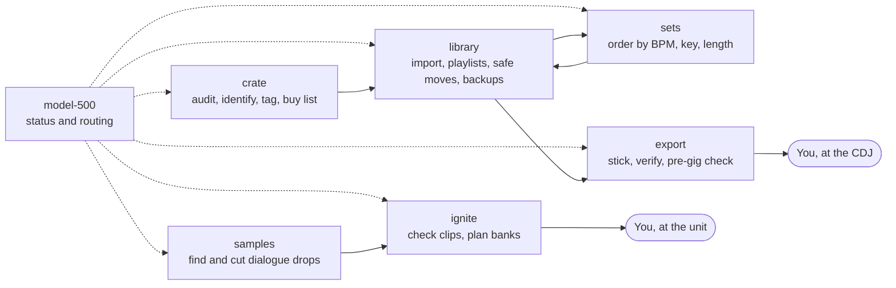

<p align="center">
  
</p>

<p align="center"><strong>DJ prep for an AI agent, with every past failure written down as a rule.</strong></p>

<p align="center">
  <a href="https://github.com/VortiMedia/model-500/actions/workflows/ci.yml"></a>
  <a href="LICENSE"></a>
  <a href="#tools-and-status"></a>
</p>

model-500 is a set of seven agent skills and two small MCP servers for [Claude Code](https://claude.com/claude-code). It is for DJs who use rekordbox on a Mac and want an agent to do the prep: clean a download folder, import and tag tracks, order a set from measured BPM and key, cut dialogue drops, and export to a USB stick. A skill is a folder of instructions that the agent loads when your request matches.

It was built on one rig and one library: 2 CDJ-3000X, DJM-A9, RMX-IGNITE, and rekordbox 7.2.19. **No stick from this suite has loaded on a CDJ-3000X, and no drop has played on an RMX-IGNITE.** The [status table](#tools-and-status) says what has run and what has not.

The name is a nod to [Juan Atkins](https://en.wikipedia.org/wiki/Juan_Atkins)'s Model 500 alias. Juan Atkins has no connection to this project and does not endorse it.

**Contents:** [Do not lists](#do-not-lists) · [Requirements](#requirements) · [Quick start](#quick-start) · [Try one script](#try-one-script) · [Skill map](#skill-map) · [Tool order](#tool-order) · [Tools and status](#tools-and-status) · [Things that will look like bugs](#things-that-will-look-like-bugs) · [Tests](#tests) · [Docs](#docs) · [Links and credits](#links-and-credits) · [Disclaimer](#disclaimer)

## Do not lists

rekordbox libraries are easy to damage and hard to check. An agent that guesses can lose real work. So each skill carries a `## Do not` list of things that went wrong in real sessions, in the same form: what the agent did, what happened, and the rule.

Two of the 42 entries in [`docs/failures.md`](docs/failures.md), as the skills hold them:

> **F06** Did: Ran `update_content_path(save=True)` to fix moved paths. Result: pyrekordbox rewrote ANLZ files: PVDI lost, PCOB, PCO2, PSSI changed. Rule: Use `safe_move.py`. Never call that function with `save=True`.

> **F12** Did: Wiped the stick, then needed a GUI export. Result: 162 stick-only tracks had no Mac copy. Rule: Diff stick against Mac and get an OK before any wipe.

Other parts you can check for yourself:

- `safe_move.py` splices only the path tag in each ANLZ file, then checks that every other tag is byte-identical.
- `safe_move.py` and `set_metadata.py` are dry runs unless you pass `--go`, and `--go` refuses while rekordbox runs.
- The mac-gui allowlist is three bundle IDs in a constant. No setting can add a fourth.
- Each skill has a "Not proven" section, so the agent does not say "works" about a step that never ran.

The ask-first rules are instructions to the agent, not locks. Keep your own backup. [SECURITY.md](SECURITY.md) lists what each tool writes.

## Requirements

- macOS. It has only run on macOS 27. `transcribe.py` needs Apple Silicon.
- [Claude Code](https://code.claude.com/docs/en/overview). Other agents are not tested.
- [uv](https://docs.astral.sh/uv/getting-started/installation/), [FFmpeg](https://ffmpeg.org/) with ffprobe, and `python3`. With [Homebrew](https://brew.sh): `brew install uv ffmpeg`.
- [rekordbox 7](https://rekordbox.com/en/download/), for the library, set, and export skills. It ran on 7.2.19. For the CDJ-3000X, use 7.2.11 or later, and avoid 7.2.12 (F16).
- Optional: RMX-IGNITE Sample Manager from [AlphaTheta](https://alphatheta.com/en/product/effector/rmx-ignite/black/) (studied at 1.0.0.0336), [Audacity 4](https://www.audacityteam.org/download/), and [yt-dlp](https://github.com/yt-dlp/yt-dlp).

You do not need the hardware for the file, library, and set work.

## Quick start

**The short way:** paste this into Claude Code. [AGENTS.md](AGENTS.md) gives the agent the steps, the gates, and the checks.

```text
Clone https://github.com/VortiMedia/model-500 to ~/model-500. Read its AGENTS.md and install it for me.
```

**By hand:** the repo must sit at `~/model-500`, and the rekordbox MCP at `~/rekordbox-mcp`. The skills use those paths.

```sh
# 1. The suite. install.sh links skills/* into ~/.claude/skills and refuses to overwrite anything.
git clone https://github.com/VortiMedia/model-500 ~/model-500
cd ~/model-500
scripts/install.sh

# 2. Your private values. Git ignores both copies. Fill in PROFILE.md.
cp state/PROFILE.example.md state/PROFILE.md
cp state/STATE.example.md state/STATE.md

# 3. This repo's MCP servers
uv sync --directory ~/model-500/mcp/ignite-mcp --frozen
uv sync --directory ~/model-500/mcp/mac-gui --frozen
claude mcp add --scope user ignite -- uv --directory ~/model-500/mcp/ignite-mcp run --frozen python server.py
claude mcp add --scope user mac-gui -- uv --directory ~/model-500/mcp/mac-gui run --frozen mac-gui

# 4. The rekordbox MCP, pinned and patched
git clone https://github.com/davehenke/rekordbox-mcp ~/rekordbox-mcp
git -C ~/rekordbox-mcp checkout d8dce67
git -C ~/rekordbox-mcp apply ~/model-500/mcp/rekordbox-mcp-path.patch
uv sync --directory ~/rekordbox-mcp --frozen
claude mcp add --scope user rekordbox -- uv --directory ~/rekordbox-mcp run --frozen rekordbox-mcp
```

Then do these once, with rekordbox closed:

```sh
# Back up the whole library folder. The MCP's own backup misses recent changes (F03).
mkdir -p ~/rekordbox-backups
cp -Rp ~/Library/Pioneer/rekordbox ~/rekordbox-backups/pre-model-500

# rekordbox encrypts its database. This checks that pyrekordbox can open it.
uv --directory ~/rekordbox-mcp run --frozen python setup-key.py
```

If the key check says no key, pyrekordbox has a command that fetches one from the internet: `uv --directory ~/rekordbox-mcp run --frozen python -m pyrekordbox download-key`. That command has not run in this build. See the [pyrekordbox docs](https://pyrekordbox.readthedocs.io). The Audacity MCP is optional and needs a custom fork, so its setup is in [docs/tools/audacity.md](docs/tools/audacity.md).

Check the install:

```sh
ls -l ~/.claude/skills | grep -c model-500   # 7
claude mcp list                              # ignite, mac-gui, rekordbox: connected
~/model-500/tests/run_all.sh                 # a tool that is absent prints SKIP
```

Start a new chat, because a new MCP loads only in a new chat. Then ask "where are we on the DJ stuff". The `model-500` skill reads your profile, reports what it finds, and routes the work.

The skills assume the build rig, and the export steps assume a CDJ-3000X. If your gear differs, put it in `state/PROFILE.md` and tell the agent.

More setup: the patch in [docs/tools/rekordbox.md](docs/tools/rekordbox.md), and macOS permissions in [docs/tools/mac-gui.md](docs/tools/mac-gui.md). `scripts/install.sh --uninstall` removes only its own links.

## Try one script

`audit_folder.py` needs only ffmpeg and reads audio without changing it. This is real output, from three tones made with ffmpeg:

```console
$ python3 -I skills/model-500-crate/scripts/audit_folder.py new-crate

=== new-crate: 3 tracks, 0.01 GB, 0.1 h, probe errors 0 []
 codec:kbps: [('mp3:128', 1), ('mp3:320', 1), ('opus:160', 1)]
 under 180s (likely previews): 1; over 900s (likely mixes): 0
 lossy under 192 kbps: 2; junk words: 1; empty artist: 2; no ' - ' in title: 3
 shortest: [('Track One (Preview).mp3', 30)]
 longest: []

=== near-duplicates by cleaned title: 1 groups
  Track One (Preview).mp3:mp3:128k:30s | Track One.mp3:mp3:320k:240s
```

The flags are leads, not facts. Rip tags are often wrong (F20).

## Skill map

Ask for a specific task and its skill loads directly. Ask a general question and the router picks one.



A set from a folder that is not in rekordbox runs crate, then library, then sets.

## Tool order

Each skill tries tools in this order, and stops at the first that can do the job:

1. **Named MCP:** `rekordbox`, `ignite`.
2. **Repo scripts:** `skills/*/scripts/`. Those that need pyrekordbox run in the `~/rekordbox-mcp` environment.
3. **GUI:** computer-use tools if the host has them, otherwise `mac-gui`.
4. **You:** only for what is physical or a decision. The agent names the exact click.

The samples skill differs. It defaults to scripts and ffmpeg, because the Audacity MCP cannot drive stock Audacity.

## Tools and status

**Proven** means it ran for real on the build Mac, on real files or a real library. **Tested on fixtures only** means automated tests on generated data. **Not run** means neither.

| Tool | Source | Status | What ran |
|---|---|---|---|
| rekordbox MCP | [davehenke/rekordbox-mcp](https://github.com/davehenke/rekordbox-mcp), with one patch | proven | Imports, playlists, and reads on a real library in past sessions |
| ignite MCP | `mcp/ignite-mcp` | tested on fixtures only | Stdio tests on generated tones and a synthetic library. No bank filled by the real app |
| mac-gui MCP, reads | `mcp/mac-gui` | tested on fixtures only | Status, AX tree, and screenshot on the test's own window |
| mac-gui MCP, input | `mcp/mac-gui` | not run | Dry runs, and guard tests with recorders. Real input has never run |
| Audacity MCP | [xDarkzx/Audacity4-MCP](https://github.com/xDarkzx/Audacity4-MCP) | not run | Needs a custom Audacity fork with a bridge on port 2212. Not driven against stock Audacity 4.0.2. Only the tool list and a clean connect error ran |
| Computer-use tools | Host app, if present | not run | Absent from the Claude Code CLI |
| `transcribe.py` | samples | proven | 7 of 7 files in a real session. The text still needs checks (F27 to F30) |
| ffmpeg trim path | samples, the default | not run | The first mining run stopped after transcription. `ignite_prepare_sample` ran its own ffmpeg path on tones |
| `make_move_map.py` | library | proven | Built a real 21-file map. Moved nothing |
| `safe_move.py`, dry run | library | proven | Planned 21 real moves. Moved nothing |
| `safe_move.py --go` | library | not run | |
| `set_metadata.py` | library | not run | `--help` only |
| `audit_folder.py` | crate | tested on fixtures only | Generated files |
| `resolve_metadata.py` | crate | tested on fixtures only | `--no-network` only. The yt-dlp and iTunes steps did not run in this build |
| `read_pdb.py` | export | not run | Reported "no export" on a real stick. The parser did not run on a real export in this build |
| `stick_vs_mac.py` | export | tested on fixtures only | Track matching on fixtures. The real stick had no tracks to match |
| CDJ-3000X load test | Hardware | not run | No stick from this suite has loaded on a CDJ |
| RMX-IGNITE playback | Hardware | not run | No drop has played on the unit. The IGNITE USB layout is inferred from app text, not from a real export |

## Things that will look like bugs

**A clean export still says "not tested on a CDJ".** That is correct. `read_pdb.py` reads `export.pdb`. The CDJ-3000X reads OneLibrary, an encrypted file this suite cannot open. Only a load test proves it (F14, F15).

**Every Audacity tool fails with a connect error.** The MCP lists 159 tools, but they talk to a bridge that exists only in a custom fork. Upstream says only Windows was built end to end. See [docs/tools/audacity.md](docs/tools/audacity.md).

**rekordbox reads show BPM 0 after analysis.** The MCP's read is stale. The agent must call `connect_database` again (F01).

**`--database-path` does nothing.** The flag is in the upstream README but not in the code. The [patch](docs/tools/rekordbox.md) fixes path detection (F04).

**The ignite MCP cannot fill a bank.** There is no write tool, on purpose. No real export has been seen, so slot edits and export stay in the Sample Manager app. See [docs/tools/ignite.md](docs/tools/ignite.md).

**mac-gui refuses your app.** It accepts three apps. That is the design, not a missing setting.

**A skill cannot find a file after you clone elsewhere.** The paths `~/model-500` and `~/rekordbox-mcp` are fixed in the skills.

## Tests

```sh
tests/run_all.sh
```

This runs the skill lint, the public-release check, the script tests, and the MCP tests. A test whose tool is absent prints SKIP. No test sends real input to any app. `test_mac_gui.py` opens one throwaway window that cannot take focus. The prompts in `tests/<skill>/triggers.md` are for a person to try. No script runs them.

[CI](.github/workflows/ci.yml) runs the lint, the public-release check, and the script tests on Ubuntu, and the MCP tests on macOS. Its comments say what stays out and why.

## Docs

[docs/README.md](docs/README.md) is the index. [AGENTS.md](AGENTS.md) is for agents that install or change this repo. [CONTRIBUTING.md](CONTRIBUTING.md) covers failure entries, new skills, and tests. [CHANGELOG.md](CHANGELOG.md) lists releases.

## Links and credits

**Code this suite runs on**

| Project | Use | Version here |
|---|---|---|
| [davehenke/rekordbox-mcp](https://github.com/davehenke/rekordbox-mcp) | rekordbox MCP server | [`d8dce67`](https://github.com/davehenke/rekordbox-mcp/tree/d8dce67), with [one patch](mcp/rekordbox-mcp-path.patch) |
| [dylanljones/pyrekordbox](https://github.com/dylanljones/pyrekordbox) ([docs](https://pyrekordbox.readthedocs.io)) | Reads and writes the rekordbox database | 0.4.3, through the MCP's lock file |
| [xDarkzx/Audacity4-MCP](https://github.com/xDarkzx/Audacity4-MCP) | Audacity MCP server, optional | [`280c7a3`](https://github.com/xDarkzx/Audacity4-MCP/tree/280c7a3f46c19c8686c53a37f788264630aa4b8c) |
| [xDarkzx/Audacity4-Dev-MCP](https://github.com/xDarkzx/Audacity4-Dev-MCP/tree/feature/mcp-audio-cleanup-pipelines) | Audacity fork with the bridge that server needs | Not built here |
| [mlx-whisper](https://github.com/ml-explore/mlx-examples/tree/main/whisper) | Transcribes dialogue | Latest, through `uv run --with` |
| [yt-dlp](https://github.com/yt-dlp/yt-dlp) | Reads source metadata, optional | Your install |
| [mutagen](https://github.com/quodlibet/mutagen) | Writes audio tags | Through the MCP's lock file |

These projects do not endorse model-500.

**Apps and tools**

- [Claude Code](https://code.claude.com/docs/en/overview), [uv](https://docs.astral.sh/uv/), [FFmpeg](https://ffmpeg.org/), [Homebrew](https://brew.sh).
- [rekordbox](https://rekordbox.com/en/download/), [Audacity](https://www.audacityteam.org/download/).
- [RMX-IGNITE](https://alphatheta.com/en/product/effector/rmx-ignite/black/). The product page and [AlphaTheta support](https://www.alphatheta.com/en/support/) are the place to look for Sample Manager and its manual.

**References for the design**

- [The Complete Guide to Building Skills for Claude](https://resources.anthropic.com/hubfs/The-Complete-Guide-to-Building-Skill-for-Claude.pdf) (Anthropic) and [Claude Code skills](https://code.claude.com/docs/en/skills).
- [Model Context Protocol](https://modelcontextprotocol.io) and [MCP in Claude Code](https://code.claude.com/docs/en/mcp).
- [Computer use tool](https://platform.claude.com/docs/en/agents-and-tools/tool-use/computer-use-tool). This suite does not call that API. See [docs/tools/computer-use.md](docs/tools/computer-use.md).
- [ASD-STE100](https://www.asd-ste100.org/), the controlled language the skills loosely follow.
- [AGENTS.md](https://agents.md), the format of this repo's agent instructions.

## Disclaimer

model-500 is not affiliated with AlphaTheta, Pioneer DJ, or Audacity. CDJ, DJM, rekordbox, RMX-IGNITE, Audacity, and other names are the trademarks of their owners.

Respect copyright. Rips and dialogue clips are for reference and for live use you have the rights to. Buy tracks before you play them out. The suite does not strip protection from audio or unlock a device. It opens only your own rekordbox database, through pyrekordbox.

This software can change your library and your stick. Back up first. It comes with no warranty.

## License

[MIT](LICENSE). Copyright VortiMedia.
